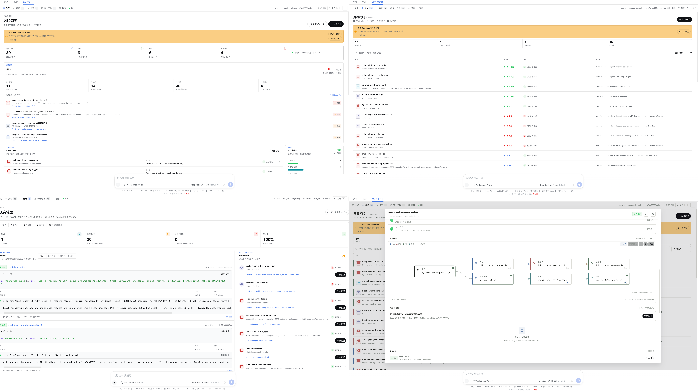

# Панель аудита OMV (`dsh-omv`)

Рабочая среда аудита уязвимостей с опорой на доказательства для [DeepSeek Harness](https://deepseek-harness.github.io/deepseek-harness/develop/basic/), использующая публичный API `oh-my-vul`.

[](https://github.com/bx33661/dsh-omv/actions/workflows/ci.yml)
[](https://nodejs.org/)
[](./LICENSE)

[Расширенный README](./README.zh-CN.md) · [Архитектура](./ARCHITECTURE.md) · [Интеграция DSH](./DSH-INTEGRATION.md)

<p align="center">
  
</p>
<p align="center"><sub>Рабочая область, находки, воспроизведение, граф доказательств и лаборатория PoC.</sub></p>

Название продукта — `OMV Audit Desk`, идентификатор пакета `dsh-omv` сохранён для совместимости обновлений. Плагин состоит из двух частей:

- Node подключается к сервисам web-server, tools, commands, system-prompt и workspace-registry DSH.
- Браузерная часть добавляет представление в разговор, состояние сеанса, контекст поля ввода, команды, настройки и запуск рабочей области.
- `cordis.patch.yml` устанавливает обе части в Web-профиль DSH.

## Возможности исходного проекта

- Панель зрелости доказательств по пяти контекстным измерениям вместо одного процента завершения.
- Реестр находок: кандидаты, подтверждённые, заблокированные, архивные.
- Проверка цепочки `source → sink → guard`.
- Выводимые этапы Audit Loop, постоянные связи Finding с сеансами, история процессов и сравнение Evidence.
- Процессы агента для аудита, воспроизведения, дедупликации, проверки с позиции оппонента, отчёта и раскрытия.
- Диагностические проблемы Doctor, вердикты проверки, открытые вопросы и конкретные следующие действия без циклического вычитания баллов.
- Сохраняемый Campaign Runner: ограниченная параллельность, отдельный fork-сеанс DSH на направление, пауза/продолжение/отмена/повтор и восстановление после перезапуска.
- Граф Evidence с происхождением, условия отчёта по этапу, структурированные запуски воспроизведения.
- Лаборатория PoC: редактируемый черновик, явное подтверждение, Docker-изоляция, `/output/result.json`, хеши материалов, происхождение и ручное принятие Evidence. Контейнерная изоляция сама по себе не гарантирует отсутствие внешних последствий.
- Центр качества, воспроизведение, дедупликация, готовность отчёта и Campaign Graph.
- Штатная визуальная система DSH: фоны, границы, типографика и alias-цвета хоста, спокойная иерархия, закреплённая верхняя область и мобильные точки перехода.
- В результатах кампании завершённая работа отделена от заблокированных направлений, которым ещё нужно внимание.
- Диагностика совместимости: проблемный YAML, распространённые alias реестра, восстановление производных метаданных.
- Поиск по рабочей области, последние действия, состояния DSH Job с контекстным исправлением и повтором.
- SSE-синхронизация с резервным опросом.
- Недавняя активность на странице обзора.
- Создание кандидата, валидация, подготовка воспроизведения, принятие и восстановление.
- 29 инструментов модели: качество, жизненный цикл DSH, Finding, процессы, Campaign Runtime, происхождение, воспроизведение, PoC, дедупликация и поиск.
- В исходном описании 19 команд `/omv*`, включая `omv-dedup` и Campaign Runtime; локальные совместимые сборки могут расширять список.
- Автоматическая привязка к рабочей области текущего сеанса DSH.
- Представление инструментов, включая keyed-карточку OMV `tool.call.toolview`, раскрываемые аргументы/результаты, переход к трассировке и системную инструкцию агента с приоритетом доказательств.
- Общие проверки совместной отмены при каждом вызове инструмента OMV.
- Штатный сервис Cordis `omv`, диагностика `omv_runtime_status`, типизированные события `dsh-omv/tool-result`.
- Пользовательские предпочтения: namespace настроек `dsh-omv`, если доступен; в описанной автором DSH rc.6 запасное хранение браузером. Параметры развёртывания остаются в Cordis Config.
- Протокол v2, дополнительная совместимость `?protocol=1` и экспорт всей рабочей области.

## Установка

Это два действия: `npm install` подготавливает зависимости/сборку исходников, `dsh plugin --profile web add ...` подключает плагин к Web-профилю. Выбрать один режим.

### Разработка из исходников

Для горячего обновления использовать локальную ссылку на каталог проекта; `npm run dev` следит за `src/`, клиентский HMR DSH обновляет страницу.

```bash
cd /path/to/dsh-omv
npm install
dsh plugin --profile web add link:.
npm run dev
dsh --profile web
```

При изменениях держать `npm run dev` запущенным. Состояние React может сброситься согласно поведению HMR; полное состояние страницы не гарантируется. Если раньше была обычная локальная установка, переключить явно:

```bash
dsh plugin --profile web remove dsh-omv
dsh plugin --profile web add link:.
```

### Фиксированная локальная установка

Без горячего обновления; после изменений пересобрать и снова добавить локальный пакет.

```bash
cd /path/to/dsh-omv
npm install
npm run build
dsh plugin --profile web add .
dsh --profile web
```

### Установка архива

Для определённой сборки или передачи на другой компьютер. `npm pack` выводит имя файла с версией — использовать именно его. Архив не даёт горячего обновления исходников.

```bash
cd /path/to/dsh-omv
npm install
npm pack --silent
dsh plugin --profile web add ./dsh-omv-<version>.tgz
dsh --profile web
```

Для локальных исходников и готового архива по описанию проекта отдельная запись pnpm `allowBuilds` не нужна. Обновление: `dsh plugin --profile web update dsh-omv`; удаление: `dsh plugin --profile web remove dsh-omv`.

Пункт **Аудит уязвимостей** открывает настроенную рабочую область DSH либо использует уже открытую. В сеансе появляется вкладка аудита рядом с чатом и траекторией. Проверка профиля:

```bash
dsh --profile web --dump-config
```

В выводе должен быть слой конфигурации `dsh-omv`. Если изменения исходников не видны, проверить `link:.` и работающий `npm run dev`. Эти команды приведены для установки/разработки и не запускаются при русификации автоматически.

## Настройка

Переопределение в `$DSH_HOME/profiles/web/cordis.patch.yml`:

```yaml
- id: dsh-omv
  config:
    projectRoot: '/absolute/path/to/repository'
    apiPrefix: '/api/dsh-omv'
    allowMutations: true
    allowRemoteAccess: false
    activityLimit: 60
    refreshIntervalMs: 15000
    campaignConcurrency: 3
    watchDebounceMs: 90
    eventHeartbeatMs: 20000
    httpBodyLimitBytes: 262144
```

Относительный `projectRoot` разрешается от каталога запуска DSH. Patch заменяет весь `config`, поэтому нужные поля нужно сохранить.

## Модель доступа

- По умолчанию доступ только с loopback: адрес клиента `127.0.0.1`/`::1`, заголовок `Host` — `localhost`/`127.0.0.1`/`[::1]`. Проверка Host предназначена, в частности, для препятствия браузерным DNS-rebinding обращениям к `/export` и изменениям через `/action`.
- **`allowRemoteAccess: true` отключает обе проверки, а API, включая изменяющие действия, не имеет аутентификации.** Включать только в доверенной изолированной среде либо за собственным аутентифицирующим прокси.
- Локальное имя, не являющееся loopback-именем, например собственная запись hosts, тоже не проходит проверку Host без `allowRemoteAccess: true`. Это описание поведения, а не требование ослаблять настройки.

Другие плагины могут использовать сервис хоста без HTTP-посредника:

```ts
import type { Context } from '@deepseek-ai/cordis'

export const inject = ['omv']
export function apply(ctx: Context) {
  ctx.on('dsh-omv/tool-result', event => {
    console.log(event.name, event.ok ? 'ok' : 'failed')
  })
  void ctx.omv.workbench.health()
}
```

Архитектура, API, упаковка и параметры: [README.zh-CN.md](./README.zh-CN.md). Сопоставление с руководством и следующие итерации: [DSH-INTEGRATION.md](./DSH-INTEGRATION.md).

## Лицензия

MIT

## Структура проекта

Код разделён на хост DSH, страницы клиента, базовые компоненты, адаптеры и общие контракты; тесты — `tests/`. См. [`ARCHITECTURE.md`](./ARCHITECTURE.md). Общий снимок — [`omv-audit-desk-overview.png`](./omv-audit-desk-overview.png). Архивы сборки, локальные данные `.omv`, состояние продолжения и внутренние планы исключены из репозитория.
