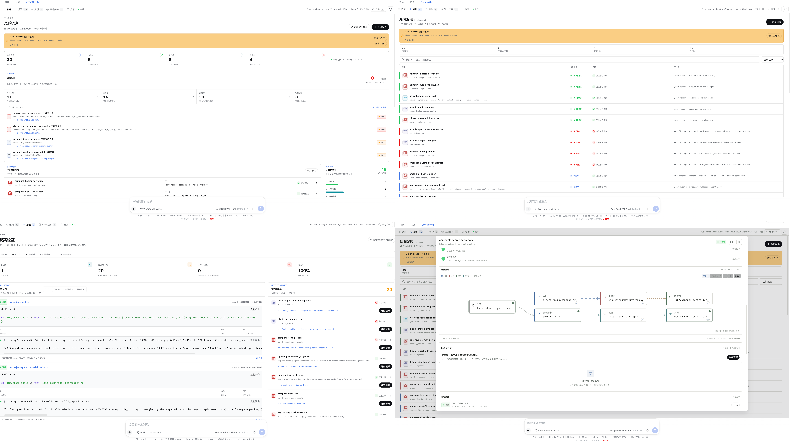
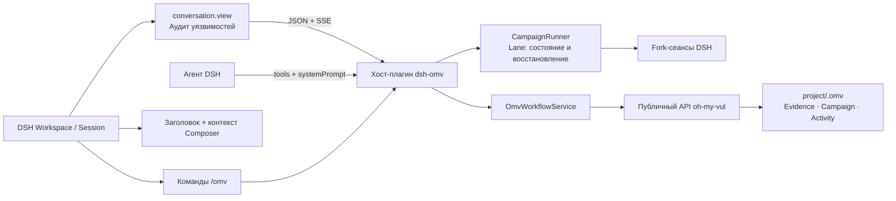

# Панель аудита OMV (dsh-omv)

`Панель аудита OMV` — рабочая среда аудита уязвимостей с опорой на доказательства для [DeepSeek Harness](https://deepseek-harness.github.io/deepseek-harness/develop/basic/). Имя пакета `dsh-omv` сохраняется для совместимости. Используются Evidence.v1, Campaign.v1, индекс рабочей области и жизненный цикл находки из `oh-my-vul`. Интеграция идёт непосредственно в workspace, сеансы, команды, инструменты, Composer и настройки DSH, без отдельной оболочки приложения.

<p align="center">
  
</p>
<p align="center"><sub>Рабочая область, находки, воспроизведение, граф доказательств и лаборатория PoC.</sub></p>

## Возможности исходного проекта

- **Обзор рисков:** активные/подтверждённые находки, распределение доказательств «ещё не сопоставлено / формируется / подкреплено / проверено / оспаривается», без усреднённого процента для разных стадий исследования.
- **Очередь аудита:** приоритет процесса OMV и конкретное следующее действие для находки.
- **Evidence.v1:** рядом `source → sink → guard`,5 измерений зрелости, открытые вопросы, Doctor и вердикты проверки.
- **Audit Loop:** candidate → investigating → reproducing → confirmed → report ready → disclosed, этап выводится из Evidence.
- **Finding ↔ Session:** постоянная привязка находки к сеансу DSH, последний процесс, хронология и восстановление.
- **Процессы агента:** глубокий аудит, воспроизведение, дедупликация, проверка с позиции оппонента, отчёт и раскрытие из карточки в текущий сеанс.
- **Evidence Diff:** хеши, добавленные/удалённые строки и компактный patch до/после действия; восстановление существующей истории при повреждении конца JSONL.
- **Реестр находок:** фильтр candidate/confirmed/blocked/archived, просмотр и восстановление архива.
- **Campaign Runner:** отдельный fork-сеанс DSH на Lane, ограниченная параллельность, пауза, продолжение, отмена, повтор неудачи, восстановление после перезапуска. Завершённое, заблокированное и ожидающее доказательств считаются отдельно.
- **Диагностика Campaign:** ошибочный YAML изолируется по файлам, alias вроде `rubygems → ruby` нормализуются, производные заголовки/runbook исправляются из панели.
- **Evidence Graph:** claim, source, sink, guard, reproducer, observed result, сеансы и материалы с прослеживаемым происхождением.
- **Условия подачи:** поток данных, проверка во время выполнения, последствия, уверенность и материалы отчёта оцениваются отдельно. На стадии кандидата — рекомендации исследования; условия подачи включаются после подтверждения и не превращают итоговый балл в доказательство.
- **Структурированный Run:** команда, сеанс, exit code, вывод, материалы; сохраняются несколько воспроизведений.
- **Лаборатория воспроизведения:** очередь, статистика выполняющихся/неудачных/заблокированных запусков, команда и окружение, новый Run из Finding.
- **Лаборатория PoC:** редактируемый черновик из Finding, проверки и явное человеческое подтверждение, Docker-изоляция; результат читается только из `/output/result.json`. Сохраняются хеши, mounts, лимиты и происхождение образа; Evidence принимается человеком отдельно. Изоляция контейнера не является гарантией отсутствия внешних последствий.
- **Центр качества:** отдельные очереди доказательств, воспроизведения, дедупликации и готовности отчёта; блокировки, замечания и рекомендации вместо жёсткого процента завершения.
- **Локальная дедупликация:** соседние Finding, сходство, причины, подтверждение/исключение и следующий шаг; разные классы уязвимостей одного пакета не должны ошибочно считаться повтором.
- **Материалы отчёта:** готовность пакета/происхождения в центре качества; черновик и раскрытие создают агенты omv-report / omv-disclose.
- **Campaign Graph:** цели, состояние, Evidence ID и исключительные ветви по Lane вместе с управлением паузой/повтором.
- **Командная панель:** `⌘K/Ctrl-K`, переходы и создание; клавиши 1–6 для шести представлений.
- **Внешний вид DSH:** alias-цвета, фон, границы и шрифт хоста без отдельной темы, градиентов и текстур. Собственная прокрутка и закреплённая навигация внутри контейнера сеанса.
- **Общий поиск:** Evidence, архив, Campaign и активность.
- **DSH Jobs:** фоновые задания текущего сеанса в обзоре/панели, повтор с контекстом сбоя для неудачного/остановленного задания.
- **Отмена:** общие проверки DSH `AbortSignal` до/после передачи Tool; длинные задачи разделены на сохраняемые начало/завершение Run.
- **Синхронизация:** SSE по изменениям `.omv`, опрос как запасной путь после разрыва.
- **Последняя активность:** записи доказательств и действий из `.omv/activity.jsonl` в обзоре.
- **Действия панели:** создание кандидата, валидация, заготовка воспроизведения, повышение статуса и восстановление архива.
- **Представление сеанса:** «Аудит уязвимостей» рядом с чатом/траекторией, тот же сеанс и Composer при переключении.
- **Workspace DSH:** боковой вход регистрирует или использует рабочую область настроенного каталога; OMV в сеансе связывается с его `cwd`.
- **Контекст сеанса:** состояние OMV в заголовке, счётчики активных/подтверждённых/заблокированных под Composer.
- **29 инструментов модели:** качество, DSH Fiber, Finding, Runner, граф, дедупликация, воспроизведение и PoC. Keyed `tool.call.toolview` показывает действие, цель, состояние, аргументы/результат и переход к траектории.
- **Команды:** исходник описывает 19 `/omv*` для чтения, создания, исправления, связей, воспроизведения, статуса, Campaign Runtime, дедупликации и поиска; действия пишутся в журнал сеанса. Локальные совместимые сборки могут добавлять команды.
- **Протокол/экспорт:** `protocolVersion: "2"`, добавочная совместимость `?protocol=1`, полный снимок области из настроек.
- **Контекст агента:** `systemPrompt` о приоритете доказательств и выборе инструментов.
- **Настройки:** стандартная область, индекс, разрешение записи, количество возможностей, переход в аудит. Последний вид сначала в `dsh-settings`; в описанной исходником rc.6 без пространства плагина — локально в браузере.
- **Устойчивость/доступность:** повреждённый Evidence изолируется, остальные данные доступны; текущая/стандартная область, время синхронизации, разрыв связи, клавиатура, семантические диалоги и закрываемые уведомления.
- **Cordis:** внедряемый `ctx.omv`, диагностика Fiber через `omv_runtime_status` и `/omv-runtime`, типизированное событие `dsh-omv/tool-result`.

## Архитектура



Это **набор DSH** из двух частей:

- `lib/index.js`: Node-хост, `webServer`, `tools`, `commands`, `systemPrompt`, `workspaceRegistry`, соединение с `oh-my-vul`.
- `lib/client.js`: браузерный bundle из `dsh.client`, регистрирующий `conversation.view`, `conversation.session.header.actions`, `conversation.composer.dock`, `conversation.chat.commandview`, `settings.section` и боковой вход.
- `cordis.patch.yml`: слой конфигурации профиля через `dsh.bundle.patch`.

Сопоставление с официальным руководством, сопровождение и план: [`DSH-INTEGRATION.md`](./DSH-INTEGRATION.md).

## Требования исходной версии

- Node.js22+.
- DeepSeek Harness `0.1.0-rc.6` либо та же серия API `0.1.x`; это исходное требование, не полная матрица всех более новых версий.
- `.omv/` может отсутствовать: первое чтение создаёт нужные каталоги.

## Установка

`npm install` подготавливает зависимости/сборку каталога проекта; `dsh plugin --profile web add ...` добавляет плагин в Web-профиль. Выбрать один режим.

### 1. Разработка с горячим обновлением

`link:.` направляет профиль на текущий checkout; `npm run dev` пересобирает bundle, client-HMR DSH Web обновляет страницу.

```bash
cd /path/to/dsh-omv
npm install
dsh plugin --profile web add link:.
npm run dev
dsh --profile web
```

При редактировании `src/` держать `npm run dev` запущенным. React-состояние может сбрасываться по правилам HMR; это не полное сохранение состояния страницы. После фиксированной установки переключить на ссылку явно:

```bash
dsh plugin --profile web remove dsh-omv
dsh plugin --profile web add link:.
```

### 2. Фиксированная локальная установка

Каталог как обычная локальная зависимость, без HMR. После изменения кода — пересборка и `add .`.

```bash
cd /path/to/dsh-omv
npm install
npm run build
dsh plugin --profile web add .
dsh --profile web
```

### 3. Архив

Для другой машины либо проверки опубликованной сборки. Использовать имя, реально выведенное `npm pack`. Установка `.tgz` не даёт горячего обновления исходников.

```bash
cd /path/to/dsh-omv
npm install
npm pack --silent
dsh plugin --profile web add ./dsh-omv-<version>.tgz
dsh --profile web
```

Локальный checkout и готовая `.tgz` по исходному описанию не требуют отдельного pnpm `allowBuilds`. Обновление: `dsh plugin --profile web update dsh-omv`, удаление: `dsh plugin --profile web remove dsh-omv`.

Внизу боковой панели DSH Web UI появляется «Аудит уязвимостей». Вход открывает соответствующий Workspace, внутри сеанса вид доступен сверху. Проверка профиля:

```bash
dsh --profile web --dump-config
```

В выводе ожидается слой `dsh-omv`. Если код изменён, а страница нет — проверить `link:.` и работающий `npm run dev`. Приведённые установочные команды не запускаются при переводе.

Кнопка «Подготовить и запустить Campaign» в задании создаёт fork-сеансы по заданной параллельности. Каждая Lane пишет результат через `omv_campaign_lane_update`; после открытия DSH восстанавливаются привязанные сеансы и очередь незавершённых задач.

## Рабочая область OMV

Исходное `projectRoot: '.'` разрешается от cwd запуска `dsh`. Переопределение в `$DSH_HOME/profiles/web/cordis.patch.yml`:

```yaml
- id: dsh-omv
  config:
    projectRoot: '/absolute/path/to/repository'
    apiPrefix: '/api/dsh-omv'
    allowMutations: true
    allowRemoteAccess: false
    activityLimit: 60
    refreshIntervalMs: 15000
    campaignConcurrency: 3
    watchDebounceMs: 90
    eventHeartbeatMs: 20000
    httpBodyLimitBytes: 262144
```

Patch заменяет весь `config`; сохранить остальные нужные поля.

## Параметры

Это значения исходного проекта, а не команда изменить существующий профиль.

| Поле | По умолчанию | Значение |
|---|---|---|
| `projectRoot` | `.` | Проект с `.omv/` |
| `apiPrefix` | `/api/dsh-omv` | Абсолютный same-origin API-путь без завершающего слеша |
| `allowMutations` | `true` | Изменяющие `.omv/` инструменты и действия UI |
| `allowRemoteAccess` | `false` | Доступ не с loopback; только при явно необходимой и защищённой сетевой схеме |
| `activityLimit` | `60` | Предел недавних событий в интерфейсе |
| `refreshIntervalMs` | `15000` | Интервал опроса, `0` отключает |
| `campaignConcurrency` | `3` | Одновременные Lane, диапазон 1–8 |
| `watchDebounceMs` | `90` | Объединение изменений `.omv`,0–10000 |
| `eventHeartbeatMs` | `20000` | SSE heartbeat,1–300000 |
| `httpBodyLimitBytes` | `262144` | JSON-тело `/action`,4096–16777216 |
| `pocEnabled` | `true` | Черновики, изолированные запуски, принятие доказательств |
| `pocAllowNetwork` | `false` | Bridge-сеть PoC-контейнера; по умолчанию без сети |
| `pocDockerImages` | `['python:3.12-slim']` | Разрешённые образы; для фиксированной воспроизводимой сборки — digest |
| `pocTimeoutMs` | `30000` | Предел длительности PoC |
| `pocMemoryMb` / `pocCpuLimit` / `pocPidLimit` | `256` / `1` / `128` | Ресурсы контейнера |
| `pocMaxScriptBytes` / `pocMaxOutputBytes` | `131072` / `65536` | Размер скрипта и материалов `/output` |

Перед запуском PoC выбирается digest из локального `RepoDigests`, выполнение — с `--pull=never`. Нужный образ сначала явно импортируется или загружается владельцем окружения. При `image@sha256:...` используется заданный digest.

## Доступ

- По умолчанию адрес клиента `127.0.0.1`/`::1`, `Host` — `localhost`/`127.0.0.1`/`[::1]`. Проверка Host препятствует браузерным DNS-rebinding обращениям к `/export` или изменяющим `/action`.
- **`allowRemoteAccess: true` отключает обе проверки, а API, включая изменяющие действия, не аутентифицирован.** Нужны доверенная изолированная среда либо собственная аутентификация перед ним.
- Собственное не-loopback имя из hosts также не проходит Host-проверку без `allowRemoteAccess: true`. Это описание механизма, не рекомендация ослаблять текущую защиту.

Другие плагины могут внедрить сервис напрямую, без HTTP:

```ts
import type { Context } from '@deepseek-ai/cordis'

export const inject = ['omv']
export function apply(ctx: Context) {
  ctx.on('dsh-omv/tool-result', event => {
    console.log(event.name, event.ok ? 'ok' : 'failed')
  })
  void ctx.omv.workbench.health()
}
```

## HTTP API

| Метод | Путь | Назначение |
|---|---|---|
| `GET` | `/api/dsh-omv/health` | Состояние плагина/корня области |
| `GET` | `/api/dsh-omv/dashboard` | Обзор, находки, задания и активность |
| `GET` | `/api/dsh-omv/finding?id=<id>` | Находка, исходное Evidence, Doctor, review |
| `GET` | `/api/dsh-omv/campaign?id=<id>` | Campaign, Lane, runbook, история сеансов |
| `GET` | `/api/dsh-omv/campaign-run?id=<id>` | Run и состояние Lane/Session |
| `GET` | `/api/dsh-omv/quality` | Качество доказательств, блокировки, очередь |
| `GET` | `/api/dsh-omv/reproductions` | Структурированные воспроизведения |
| `GET` | `/api/dsh-omv/poc?findingId=<id>` | Черновики/изолированные запуски Finding |
| `GET` | `/api/dsh-omv/poc-run?id=<id>` | Run, результат, хеши, происхождение |
| `GET` | `/api/dsh-omv/dedup?id=<id>` | Сходство/совпадения Finding |
| `GET` | `/api/dsh-omv/search?q=<query>` | Общий поиск |
| `GET` | `/api/dsh-omv/events` | SSE-изменения `.omv` |
| `GET` | `/api/dsh-omv/protocol` | Версии протокола/совместимости |
| `GET` | `/api/dsh-omv/export` | Полный снимок v2 |
| `POST` | `/api/dsh-omv/action` | Типизированное действие |

Порядок PoC: `poc.generate` → `poc.draft.save` → `poc.draft.approve` → `poc.run.start` → `poc.run.inspect` → `poc.evidence.adopt`. Успешный запуск не подтверждает уязвимость; только `poc.evidence.adopt` обозначает явное человеческое принятие Evidence.

Ответы: `{ ok: true, data }` либо `{ ok: false, error }`, заголовок `Cache-Control: no-store`.

## Проверки качества

```bash
npm run typecheck   # strict TypeScript
npm test            # 工作区与 HTTP 桥接测试
npm run build       # Node + DSH client bundle
npm pack --dry-run  # 发布内容核对
```

## Лицензия

MIT

## Структура

Хост, страницы клиента, базовые компоненты, адаптеры и типы протокола разделены; тесты — в `tests/`. Подробнее: [`ARCHITECTURE.md`](./ARCHITECTURE.md). Снимок: [`omv-audit-desk-overview.png`](./omv-audit-desk-overview.png). Сборки, архивы, локальная `.omv`, состояние продолжения и внутренние планы исключаются через `.gitignore`.
